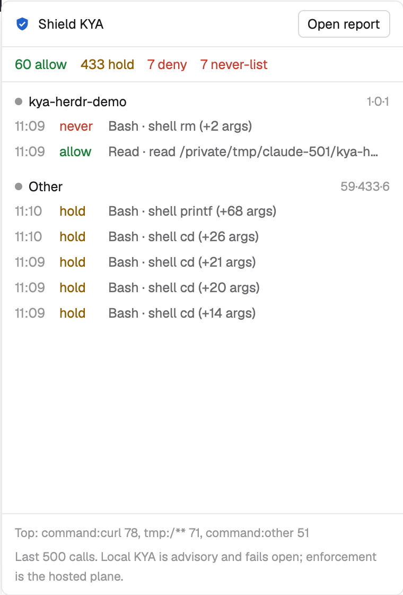

# Shield KYA mod for Herdr

A [Herdr](https://herdr.dev) window that shows what [Shield KYA](https://github.com/The-Pixel-Boys/shield-kya) recorded for your coding agents: each tool call with its verdict (allow, hold, deny), never-list hits, grouped by Herdr space. A toast appears when KYA denies a call. "Open report" opens the full KYA report.

Local KYA is advisory and fails open; enforcement is the hosted plane. The mod never approves, denies or changes a verdict.

## Install

1. Install KYA and wire your agents: `npm i -g @shield-agent/kya && kya start`.
2. Ask your Herdr agent to add `herdr.dev/mods/The-Pixel-Boys/kya-herdr-mod`, or copy `mods/kya` to `~/.config/herdr-app/mods/kya` and merge `keys.json` into `~/.config/herdr-app/keys.json`.
3. Run `herdr-app check ~/.config/herdr-app/mods/kya`, then press `alt-k` (or `herdr-app do mod.open '{"name":"kya"}'`).

## What it runs and reads

- Reads only the end of the KYA record: `tail -n 500 ~/.kya/trail.jsonl` (`$KYA_HOME/.kya` when set). It shows the redacted `summary` field only.
- Runs `sh` (to find `kya` and `KYA_HOME`), `tail`, and `kya receipt --open` when you press "Open report". That command writes report files in `~/.kya/receipts`, starts the local KYA report server, and sends anonymous usage stats only if you opted in.
- The mod has no network code of its own.

How it looks and behaves in detail: [RECIPE.md](RECIPE.md). Tested on Herdr 0.1.14 with KYA 0.33.4 on macOS.

## Test

`node --test test/*.test.mjs`

## License

MIT
