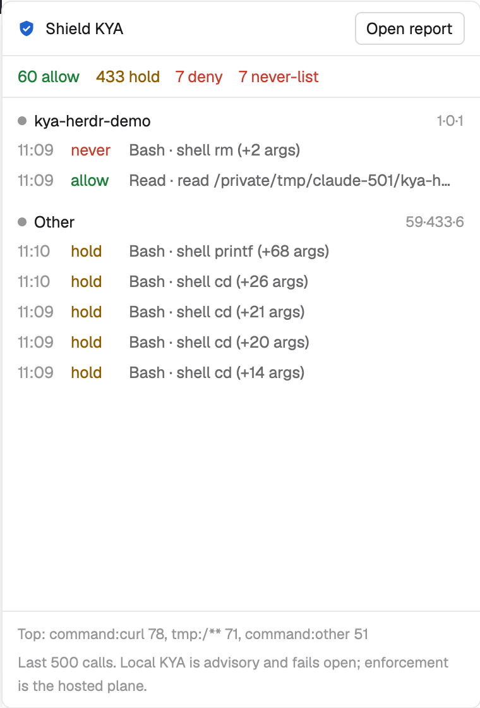

# Shield KYA

A floating window that shows what [Shield KYA](https://github.com/The-Pixel-Boys/shield-kya) recorded for your coding agents: every tool call, its verdict (allow, hold, deny), never-list hits, grouped by Herdr space. A toast pops when KYA denies a call. One button opens the full KYA report.

## What you see

- A window, 380 x 560 logical px, kept open across spaces and restarts (key `kya`, `keep: true`). `alt-k` toggles it (`keys.json`).
- Header (about 40 px): shield icon (`kya.svg`, tinted `accent`), "Shield KYA" in semibold, an "Open report" button with a 1 px `input` border, radius 5.
- Totals row: `N allow` (`ansi2`), `N hold` (`ansi3`), `N deny` (`blocked`), and `N never-list` (`blocked`) when above zero. Counts cover the last N calls (N is at most 500).
- Body, scrolling: one section per Herdr space that has KYA calls, newest first; a section named "Other" last for calls that match no space. Each section: a 7 px status dot (the most urgent agent status in that space, `dim` when none), the space name, `allow·hold·deny` counts, then the 5 newest calls: time `HH:MM` (`dim`), verdict (`never` for a never-list hit), `tool · summary` (truncated).
- Footer (11.5 px, `dim`): top 3 target classes (navigation-only `command:cd`, `command:ls`, `command:pwd` left out), and the line "Last N calls. Local KYA is advisory and fails open; enforcement is the hosted plane." (N is at most 500).

## How it behaves

- Reads only the end of the KYA record: `tail -n 500 ${KYA_HOME:-$HOME}/.kya/trail.jsonl`. Refreshes when anything under `~/.kya` changes (`watchFolder`), and every 15 s.
- A call belongs to a space when the space folder's last path part equals the call's `project`. With two such spaces, the one running an agent of the same product wins (`claude-code` is `claude`).
- Status dot: the most urgent agent status in the space, in priority blocked, working, done, idle, drawn in the theme colour of that name (`blocked`, `working`, `done`, `idle`). No agent in the space: `dim`.
- New denies and never-list hits after the window opened post a `warning` toast, at most 3 per refresh, each once. Titles: "KYA never-list hit" or "KYA flagged a call: deny". Calls already in the record when it opens never toast.
- "Open report" runs `kya receipt --open` from your home folder: it writes report files in `~/.kya/receipts`, starts the local KYA report server, and sends anonymous usage stats only if you turned them on. Timeout 20 s. On failure the footer says to run it by hand.
- No record file and no `kya` on `PATH`: the body shows the install line `npm i -g @shield-agent/kya && kya start`. No record file but `kya` found: "No KYA record yet. Run: kya start". A record that exists shows even without `kya` on `PATH`.
- The mod never approves, denies or changes a verdict.

## Built from

- `mods/kya/main.js` (the view), `mods/kya/trail.js` (pure parsing and grouping, no Herdr imports), `mods/kya/kya.svg`, `mods/kya/mod.json` (`place: none`, `overlay: { kind: window, width: 380, height: 560, key: kya, keep: true }`), `keys.json`.
- `herdr` functions: `spaces()`, `agents()`, `exec()`, `watchFolder()`, `notify()`, `theme()`.
- Programs it runs: `sh` (to read `KYA_HOME` and find `kya`), `tail`, `kya receipt --open`. The mod reads files only under `~/.kya` and has no network code of its own; see "Open report" for what `kya receipt --open` does.

## Watch out

- The KYA record has no size limit on disk (it can be tens of MB). Never `readTextFile` it (1 MiB cap); tail it.
- Show only the trail's `summary` field: kya redacts it. Never show raw arguments.
- Herdr only gives its own Files and Changes panels a tab-bar button, so this is a window, not a docked panel.
- Matching by folder name is a guess: two projects with the same folder name share a section, and remote spaces are not separated from local ones.
- `watchFolder` on `~/.kya` also fires for kya stamp files: refresh only when `trail.jsonl` (or the root) is in the batch.
- Tested on Herdr 0.1.14 and Shield KYA 0.33.4, macOS.

## Done when

- `herdr-app check mods/kya` passes.
- `node --test test/*.test.mjs` passes (parser).
- With a space whose folder is `demo`, `echo '{"session_id":"s","tool_name":"Bash","tool_input":{"command":"rm -rf ~"},"cwd":"/path/demo","hook_event_name":"PreToolUse"}' | kya hook` makes a `never` row appear under that space and one toast.
